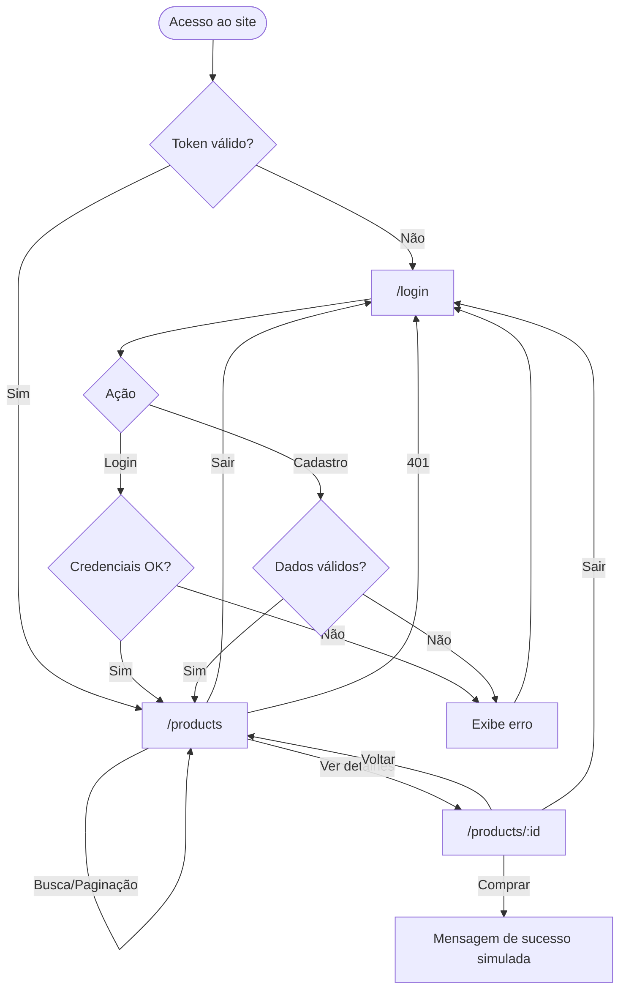

# SEÇÃO B — Especificação UI/UX

## 1. Design System

### Paleta
| Token | Hex | Uso |
|---|---|---|
| primary | `#4F46E5` | Botões, links, preço |
| primary-dark | `#4338CA` | Hover |
| bg | `#F8FAFC` | Fundo da página |
| surface | `#FFFFFF` | Cards, formulários |
| border | `#E2E8F0` | Bordas |
| text | `#0F172A` | Texto principal |
| text-muted | `#64748B` | Texto secundário |
| error | `#B91C1C` / bg `#FEF2F2` | Erros |
| success | `#15803D` / bg `#F0FDF4` | Sucesso |

### Tipografia (Inter, fallback system-ui)
| Nível | Tamanho / peso |
|---|---|
| H1 | 24–30px / 700 |
| Preço | 18–24px / 700 |
| Título card | 16px / 600 |
| Corpo | 14–16px / 400 |
| Legenda | 12–14px / 400 |

### Espaçamento e forma
Escala de 4px (4, 8, 12, 16, 24, 32). Raio: inputs/botões 8px, cards 12px, formulário 16px. Sombra leve `sm` → `md` no hover. Container máx. 1152px.

### Hierarquia visual
1. Preço e CTA (cor primary) → 2. Título → 3. Descrição/metadados (muted).

Breakpoints: mobile 1 coluna · `sm` 2 · `lg` 4.

## 2. Wireframes

### Login / Cadastro
```
+--------------------------------------+
|                                      |
|        +----------------------+      |
|        |      Loja ED         |      |
|        |  Entre na sua conta  |      |
|        | [! mensagem de erro] |      |
|        | E-mail               |      |
|        | [__________________] |      |
|        | Senha                |      |
|        | [__________________] |      |
|        | [      Entrar       ]|      |
|        | Não tem conta? Cadastre-se   |
|        +----------------------+      |
+--------------------------------------+
(modo cadastro: adiciona campo "Nome")
```

### Catálogo
```
+------------------------------------------------------+
| Loja ED                         Olá, Ana   [ Sair ]  |
+------------------------------------------------------+
| Catálogo                     [ Buscar produto... ]   |
|                                                      |
| +--------+ +--------+ +--------+ +--------+          |
| | [img]  | | [img]  | | [img]  | | [img]  |          |
| | Título | | Título | | Título | | Título |          |
| | R$ 0,00| | R$ 0,00| | R$ 0,00| | R$ 0,00|          |
| |[Detalh]| |[Detalh]| |[Detalh]| |[Detalh]|          |
| +--------+ +--------+ +--------+ +--------+          |
|   (2ª linha idem)                                    |
|        [Anterior]  Página 1 de 2  [Próxima]          |
+------------------------------------------------------+
```

### Detalhe
```
+------------------------------------------------------+
| Loja ED                         Olá, Ana   [ Sair ]  |
+------------------------------------------------------+
| ← Voltar ao catálogo                                 |
| +--------------------+  Nome do Produto              |
| |                    |  R$ 299,90                    |
| |      [imagem]      |  Descrição completa...        |
| |                    |  25 em estoque                |
| |                    |  [ ✔ Compra simulada ok ]     |
| +--------------------+  [      Comprar       ]       |
+------------------------------------------------------+
(mobile: imagem acima, informações abaixo)
```

## 3. Fluxograma de Navegação


| Rota | Acesso | Tela |
|---|---|---|
| `/login` | Pública (logado → `/products`) | Login/Cadastro |
| `/products` | Privada | Catálogo |
| `/products/:id` | Privada | Detalhe |
| `*` | — | Redireciona a `/products` |

## 4. Guia Figma

1. **Arquivo:** novo Design File "Loja ED". Páginas: `Design System`, `Telas`, `Protótipo`.
2. **Estilos:** em *Local styles* crie Color styles com os hex acima (`primary`, `bg`, `surface`, `border`, `text`, `text-muted`, `error`, `success`). Text styles: H1, Preço, Título, Corpo, Legenda (Inter).
3. **Grid/Frames:** Desktop 1440×1024, Mobile 390×844. Layout grid desktop: 12 colunas, margem auto, largura máx. 1152. Mobile: 4 colunas, margem 16.
4. **Componentes** (Ctrl+Alt+K, usar *Auto Layout* — Shift+A):
   - **Button/Primary:** retângulo raio 8, fill primary, padding 8×16, texto branco 14/500. Variants: `Default`, `Hover` (primary-dark), `Disabled` (opacidade 50%). Crie *Component set* com property `State`.
   - **Input:** altura 40, borda 1px `border`, raio 8, padding 8×12. Variants `Default`, `Focus` (borda 2px primary), `Error` (borda error + texto de ajuda).
   - **Alert:** auto layout horizontal, fill error-bg, borda error, raio 8. Variant `Success`.
   - **Product Card:** frame 264 de largura, raio 12, borda 1px, auto layout vertical: imagem 264×176 (fill: image), container padding 16 com Título, Preço e Button. Variant `Hover` com sombra.
   - **Navbar:** altura 64, fill surface, borda inferior; logo à esquerda, nome + botão "Sair" à direita.
5. **Telas:** monte `Login`, `Cadastro` (duplicar + campo Nome), `Catálogo` (grid auto layout wrap, 4 colunas desktop; 1 coluna mobile), `Detalhe` (2 colunas desktop). Use instâncias dos componentes.
6. **Protótipo** (aba *Prototype*):
   - Botão "Entrar" → Catálogo (*On click → Navigate to*, *Smart animate* 200ms).
   - "Cadastre-se" ↔ "Entrar" → alterna Login/Cadastro.
   - Card/botão "Ver detalhes" → Detalhe.
   - "Voltar ao catálogo" → Catálogo (*Back*).
   - "Comprar" → trocar variante para estado com Alert Success (*Change to*).
   - "Sair" → Login.
   - Defina o Login como *Starting point*.
7. **Entrega:** *Share → Anyone with link can view* + exportar `.fig` (File → Save local copy).
