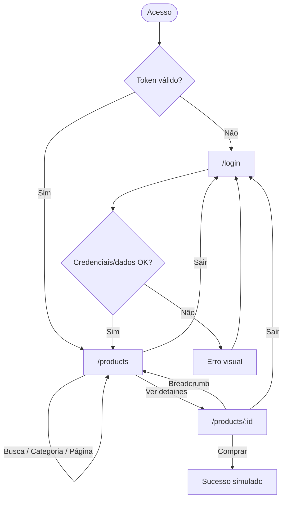
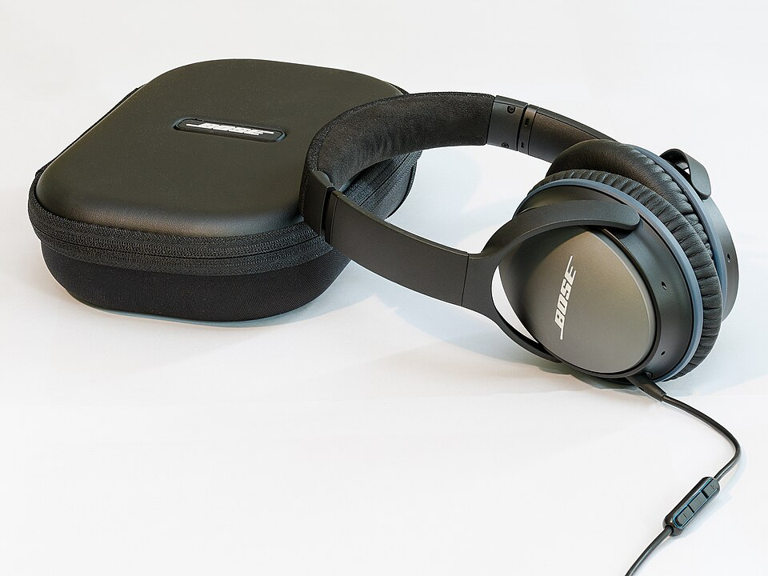
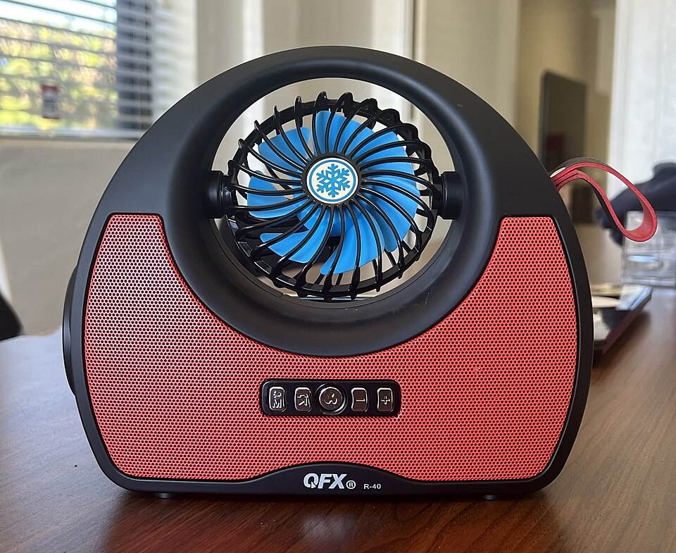
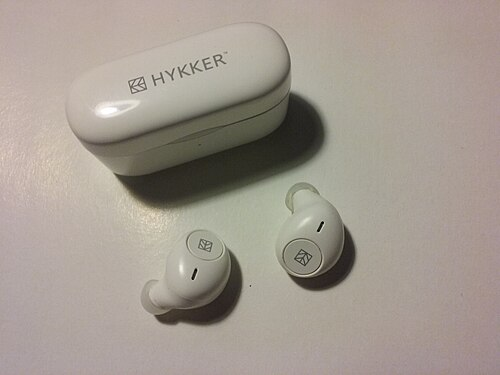
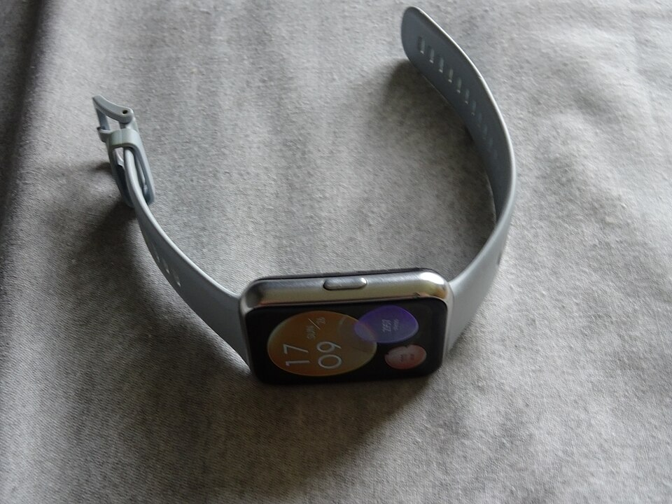
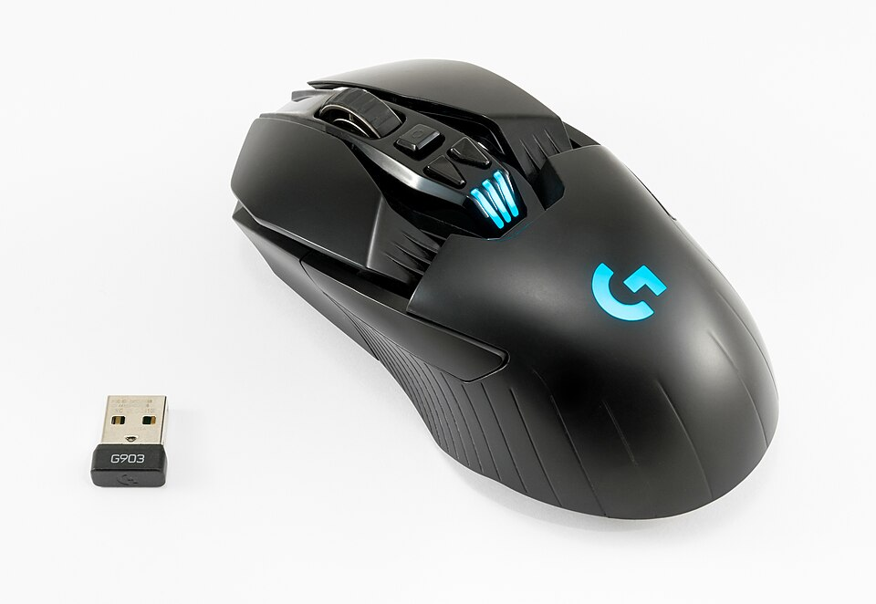
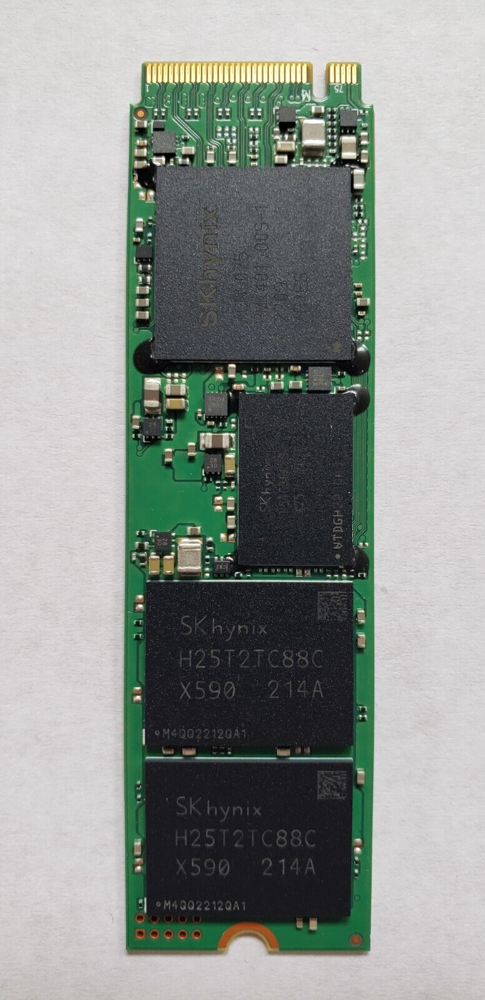
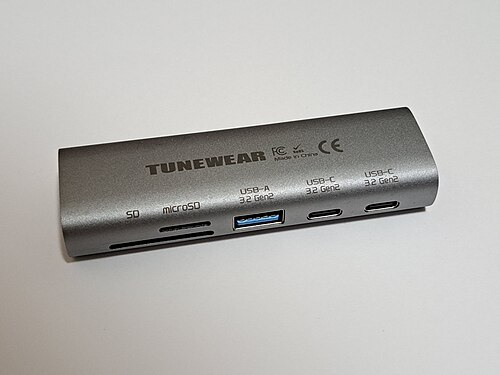

## 1. Visão Geral

**Loja ED** é um e-commerce simplificado de **Eletrônicos e Periféricos de Informática**. Usuários autenticados (JWT) navegam por um catálogo paginado com busca e filtro de categorias, inspecionam especificações técnicas e simulam uma compra. Administradores cadastram produtos via API.

| Camada | Tecnologia |
|---|---|
| Backend | Java 17+ (testado com JDK 21), Spring Boot 3.2, Spring Security + JWT (stateless), Spring Data JPA, H2 em memória |
| Frontend | React 18, Vite 5, TypeScript, Tailwind CSS 3, React Router 6, Axios, Context API |
| Arquitetura | Camadas: Controller → Service → Repository → Entity, com DTOs (records) |

**Escopo incluído:** cadastro/login, sessão persistida, catálogo (busca + categoria + paginação), detalhe do produto, compra simulada, cadastro de produto (ADMIN).
**Fora do escopo:** pagamento real, carrinho persistente, pedidos, upload de imagens, tela administrativa.

## 2. Personas

| Persona | Perfil | Objetivo |
|---|---|---|
| **Visitante** | Sem conta | Criar conta para acessar a loja |
| **Cliente (USER)** | Compra eletrônicos para estudo/trabalho | Encontrar, comparar e "comprar" produtos |
| **Administrador (ADMIN)** | Gestor do catálogo | Cadastrar produtos e manter o catálogo atualizado |

## 3. Histórias de Usuário

| ID | História (Como… quero… para que…) | Prioridade |
|---|---|---|
| US01 | Como **visitante**, quero me cadastrar com nome, e-mail e senha, para que eu possa acessar a loja. | Alta |
| US02 | Como **cliente**, quero fazer login, para que eu acesse as áreas protegidas com segurança. | Alta |
| US03 | Como **cliente**, quero que minha sessão persista ao recarregar a página, para que eu não precise logar a cada visita. | Alta |
| US04 | Como **cliente**, quero encerrar minha sessão, para que ninguém use minha conta em um computador compartilhado. | Média |
| US05 | Como **cliente**, quero listar produtos com paginação, para que eu navegue sem carregar o catálogo inteiro. | Alta |
| US06 | Como **cliente**, quero buscar produtos por nome, para que eu encontre rapidamente o que preciso. | Alta |
| US07 | Como **cliente**, quero filtrar por categoria, para que eu compare itens do mesmo tipo. | Média |
| US08 | Como **cliente**, quero ver o status de estoque nos cards, para que eu saiba se o item está disponível antes de abrir o detalhe. | Média |
| US09 | Como **cliente**, quero ver descrição, especificações técnicas e imagens do produto, para que eu decida a compra com segurança. | Alta |
| US10 | Como **cliente**, quero escolher a quantidade e simular a compra, para que eu valide o fluxo de compra. | Média |
| US11 | Como **administrador**, quero cadastrar produtos, para que o catálogo seja atualizado. | Alta |
| US12 | Como **sistema**, quero impedir que clientes executem ações administrativas, para que a loja permaneça íntegra. | Alta |

## 4. Critérios de Aceite (BDD / Gherkin)

### 4.1 Autenticação e persistência de sessão JWT (US01–US04)

```gherkin
Funcionalidade: Autenticação

  Cenário: Cadastro com sucesso
    Dado que sou um visitante na tela de cadastro
    Quando informo nome, e-mail inédito e senha com 6 ou mais caracteres e envio
    Então a conta é criada com perfil USER
    E vejo a mensagem "Conta criada com sucesso!"
    E sou redirecionado ao catálogo já autenticado

  Cenário: E-mail já cadastrado
    Dado que já existe um usuário com o e-mail informado
    Quando envio o formulário de cadastro
    Então vejo a mensagem "E-mail já cadastrado" (HTTP 409)

  Cenário: Validação visual de campos
    Dado que estou na tela de login
    Quando envio o formulário com e-mail malformado ou senha com menos de 6 caracteres
    Então os campos inválidos ficam com borda vermelha e mensagem explicativa
    E nenhuma requisição é enviada ao servidor

  Cenário: Login válido
    Dado que possuo uma conta
    Quando informo e-mail e senha corretos
    Então recebo um token JWT
    E vejo a mensagem "Login realizado!"
    E sou redirecionado ao catálogo

  Cenário: Credenciais inválidas
    Dado que informo uma senha incorreta
    Quando envio o login
    Então vejo "E-mail ou senha inválidos" (HTTP 401)
    E permaneço na tela de login

  Cenário: Persistência de sessão
    Dado que estou autenticado
    Quando recarrego a página (F5)
    Então continuo autenticado, pois o token é lido do armazenamento local

  Cenário: Rota privada sem sessão
    Dado que não estou autenticado
    Quando acesso "/products"
    Então sou redirecionado para "/login"

  Cenário: Token expirado ou inválido
    Dado que meu token expirou
    Quando faço uma requisição protegida
    Então a API responde HTTP 401
    E a sessão local é limpa e sou levado ao login

  Cenário: Logout
    Dado que estou autenticado
    Quando clico em "Sair"
    Então o token é removido e sou redirecionado ao login
```

### 4.2 Navegação, busca e visualização do catálogo (US05–US08)

```gherkin
Funcionalidade: Catálogo de produtos

  Cenário: Listagem paginada
    Dado que estou autenticado e existem 9 produtos
    Quando acesso o catálogo
    Então vejo 8 cards com imagem, título, preço, categoria, status de estoque e botão "Ver detalhes"
    E o controle de paginação exibe "Página 1 de 2"

  Cenário: Busca por nome
    Dado que estou no catálogo
    Quando digito "mouse" no campo de busca
    Então apenas produtos cujo nome contém "mouse" (sem diferenciar maiúsculas) são exibidos

  Cenário: Filtro por categoria
    Dado que estou no catálogo
    Quando clico na categoria "Áudio"
    Então somente produtos da categoria "Áudio" são exibidos
    E a categoria selecionada fica destacada

  Cenário: Busca combinada com categoria
    Dado que a categoria "Periféricos" está selecionada
    Quando busco por "teclado"
    Então vejo apenas produtos de "Periféricos" cujo nome contém "teclado"

  Cenário: Sem resultados
    Quando busco um termo inexistente
    Então vejo "Nenhum produto encontrado."

  Cenário: Status visual do estoque
    Dado que um produto tem estoque 0
    Então seu card exibe o selo "Esgotado" e a imagem esmaecida
    E produtos com até 10 unidades exibem "Últimas N unidades"
    E os demais exibem "Em estoque"
```

### 4.3 Inspeção técnica do produto (US09–US10)

```gherkin
Funcionalidade: Detalhe do produto

  Cenário: Ver detalhe completo
    Dado que estou no catálogo
    Quando clico em "Ver detalhes" de um produto
    Então vejo breadcrumb "Catálogo / Categoria / Nome"
    E galeria de imagens, preço, status de estoque, descrição e tabela de especificações técnicas

  Cenário: Alternar imagem da galeria
    Dado que estou no detalhe de um produto
    Quando clico em uma miniatura da galeria
    Então a imagem principal muda para o enquadramento selecionado

  Cenário: Selecionar quantidade
    Dado que o produto tem estoque 5
    Quando incremento a quantidade
    Então o seletor não permite ultrapassar 5 nem ficar abaixo de 1

  Cenário: Compra simulada
    Dado que escolhi a quantidade 2 de um produto com estoque
    Quando clico em "Comprar"
    Então vejo "Compra simulada realizada com sucesso! (2 unidades)"

  Cenário: Produto esgotado
    Dado que o produto tem estoque 0
    Então o botão exibe "Indisponível" e fica desabilitado

  Cenário: Produto inexistente
    Quando acesso "/products/9999"
    Então vejo "Produto não encontrado." (HTTP 404)
```

### 4.4 Gestão de acessos e permissões — Cliente vs. Administrador (US11–US12)

```gherkin
Funcionalidade: Controle de acesso por perfil

  Cenário: Administrador cadastra produto
    Dado que possuo token com perfil ADMIN
    Quando envio POST /api/products com dados válidos
    Então recebo HTTP 201 com o produto criado

  Cenário: Cliente tenta cadastrar produto
    Dado que possuo token com perfil USER
    Quando envio POST /api/products
    Então recebo HTTP 403

  Cenário: Requisição sem token
    Dado que não envio o cabeçalho Authorization
    Quando consulto GET /api/products
    Então recebo HTTP 401

  Cenário: Cadastro público não cria administradores
    Dado que um visitante envia POST /api/auth/register
    Então o usuário criado sempre possui o perfil USER

  Cenário: Dados inválidos no cadastro de produto
    Dado que possuo token ADMIN
    Quando envio um produto com preço menor que 0,01
    Então recebo HTTP 400 com a mensagem de validação
```

## 5. Especificação de UI/UX

### 5.1 Ferramenta e entregáveis

| Item | Definição |
|---|---|
| **Ferramenta de design** | **Figma** (guia de montagem na seção 5.6) |
| **Protótipo em código** | O próprio frontend (React + Tailwind) é o protótipo visual interativo: `npm run dev` abre as 3 telas funcionais em `http://localhost:5173`. Os tokens abaixo são idênticos aos de `tailwind.config.js`. |
| **Telas** | Login/Cadastro · Catálogo · Detalhe do Produto |
| **Breakpoints** | Mobile < 640 px (1 coluna) · `sm` ≥ 640 px (2 col.) · `lg` ≥ 1024 px (4 col.) |

### 5.2 Design Tokens

#### Cores

| Token | Hex | RGB | Uso |
|---|---|---|---|
| `primary` | `#4F46E5` | 79, 70, 229 | Botões, links, preço, foco |
| `primary-dark` | `#4338CA` | 67, 56, 202 | Hover de botões |
| `bg` | `#F8FAFC` | 248, 250, 252 | Fundo da página |
| `surface` | `#FFFFFF` | 255, 255, 255 | Cards, formulários |
| `border` | `#E2E8F0` | 226, 232, 240 | Bordas, divisores |
| `text` | `#0F172A` | 15, 23, 42 | Texto principal |
| `text-muted` | `#64748B` | 100, 116, 139 | Texto secundário |
| `error` | `#B91C1C` (fundo `#FEF2F2`) | 185, 28, 28 | Erros, "Esgotado" |
| `success` | `#15803D` (fundo `#F0FDF4`) | 21, 128, 61 | Sucesso, "Em estoque" |
| `warning` | `#B45309` (fundo `#FFFBEB`) | 180, 83, 9 | "Últimas unidades" |

#### Tipografia — Inter (fallback `system-ui, sans-serif`)

| Estilo | Tamanho / altura de linha | Peso | Uso |
|---|---|---|---|
| Display | 30 / 36 px | 700 | Título do produto (desktop) |
| H1 | 24 / 32 px | 700 | Títulos de tela |
| H2 | 18 / 28 px | 600 | Preço no card, seções |
| Corpo | 16 / 24 px | 400 | Descrições |
| Corpo pequeno | 14 / 20 px | 400–500 | Botões, labels, tabelas |
| Legenda | 12 / 16 px | 500 | Selos, mensagens de ajuda |

#### Espaçamento (grid 8pt) e forma

| Token | Valor | Uso |
|---|---|---|
| `space-1` (meio passo) | 4 px | Ícones, selos (exceção densa) |
| `space-2` | 8 px | Gap entre elementos próximos |
| `space-3` | 16 px | Padding de cards/inputs |
| `space-4` | 24 px | Gap do grid, padding de formulários |
| `space-5` | 32 px | Separação de seções |
| `space-6` | 48 px | Margens verticais de página |
| Raio | 8 px (inputs/botões) · 12 px (cards) · 16 px (formulário) · 9999 px (selos/chips) | |

#### Sombras

| Token | CSS | Uso |
|---|---|---|
| `shadow-sm` | `0 1px 2px rgba(0,0,0,.05)` | Cards em repouso |
| `shadow-md` | `0 4px 6px -1px rgba(0,0,0,.10), 0 2px 4px -2px rgba(0,0,0,.10)` | Hover de cards, formulário de login |

#### Hierarquia visual
1. **Preço e CTA** (cor `primary`) → 2. **Título** → 3. **Selo de estoque/categoria** → 4. Descrição e metadados (`text-muted`).

### 5.3 Wireframes

#### Login / Cadastro
```text
+--------------------------------------+
|                                      |
|        +----------------------+      |
|        |       Loja ED        |      |
|        |  Entre na sua conta  |      |
|        | [✔ Login realizado!] |      |   <- sucesso (verde)
|        | [✖ Erro do servidor] |      |   <- erro (vermelho)
|        | Nome   (só cadastro) |      |
|        | [__________________] |      |
|        | E-mail               |      |
|        | [__________________] |      |   <- borda vermelha + dica se inválido
|        | Senha                |      |
|        | [__________________] |      |
|        | [      Entrar       ]|      |
|        | Não tem conta? Cadastre-se   |
|        +----------------------+      |
+--------------------------------------+
```

#### Catálogo
```text
+--------------------------------------------------------+
| Loja ED                           Olá, Ana    [ Sair ] |
+--------------------------------------------------------+
| Catálogo                        [ Buscar produto...  ] |
| (Todos) (Áudio) (Wearables) (Periféricos) (Armazen.)   |
|                                                        |
| +---------+ +---------+ +---------+ +---------+        |
| |[Áudio]  | |[Áudio]  | |[Wearab.]| |[Perif.] |        |
| | [img]   | | [img]   | | [img]   | | [img]   |        |
| | Título  | | Título  | | Título  | | Título  |        |
| | R$ 0,00 | | R$ 0,00 | | R$ 0,00 | | R$ 0,00 |        |
| | ●Estoque| | ●Esgot. | | ●Últimas| | ●Estoque|        |
| |[Detalhe]| |[Detalhe]| |[Detalhe]| |[Detalhe]|        |
| +---------+ +---------+ +---------+ +---------+        |
|           [Anterior]  Página 1 de 2  [Próxima]         |
+--------------------------------------------------------+
```

#### Detalhe do Produto
```text
+--------------------------------------------------------+
| Loja ED                           Olá, Ana    [ Sair ] |
+--------------------------------------------------------+
| Catálogo / Periféricos / Mouse Gamer Sem Fio           |
| +---------------------+  Nome do Produto               |
| |                     |  R$ 329,90   ● Em estoque      |
| |   [imagem grande]   |  Descrição comercial...        |
| |                     |  Especificações técnicas       |
| +---------------------+  | Conexão    | 2,4 GHz     |  |
| [mini1] [mini2] [mini3]  | Sensor     | Óptico      |  |
|                          [ - ] 1 [ + ]  [  Comprar  ]  |
+--------------------------------------------------------+
(mobile: imagem acima, informações abaixo)
```

### 5.4 Fluxo de navegação



| Rota | Acesso | Tela |
|---|---|---|
| `/login` | Pública (logado → `/products`) | Login/Cadastro |
| `/products` | Privada | Catálogo |
| `/products/:id` | Privada | Detalhe |
| `*` | — | Redireciona para `/products` |

### 5.5 Componentes e variantes

| Componente | Variantes | Especificação |
|---|---|---|
| Button/Primary | Default · Hover · Disabled | Altura 40, padding 8×16, raio 8, fill `primary`, texto branco 14/500 |
| Input | Default · Focus · Error · Success | Altura 40, borda 1 px `border`; Focus: anel 2 px `primary`; Error: borda `error` + fundo `#FEF2F2`; Success: borda `success` |
| Alert | Error · Success | Auto layout horizontal, raio 8, fundo/borda do tom correspondente |
| Chip (categoria) | Default · Selected | Raio 9999, padding 6×12; Selected: fill `primary`, texto branco |
| Stock Badge | Em estoque · Últimas N · Esgotado | Raio 9999, 12/500, fundo/borda de `success`/`warning`/`error` |
| Product Card | Default · Hover · Esgotado | Largura 264, raio 12, imagem 3:2, padding 16, gap 4 |
| Quantity Stepper | Default · Min · Max | Borda 1 px, botões −/+ 40×40, valor centralizado |
| Navbar | — | Altura 64, fill `surface`, borda inferior |

### 5.6 Guia passo a passo no Figma

1. **Arquivo:** crie o Design File "Loja ED" com as páginas `Design System`, `Telas` e `Protótipo`.
2. **Estilos:** em *Local styles*, crie *Color styles* com os tokens da seção 5.2 e *Text styles* (Display, H1, H2, Corpo, Corpo pequeno, Legenda — Inter). Crie *Effect styles* `shadow-sm` e `shadow-md`.
3. **Frames:** Desktop **1440 × 1024** e Mobile **390 × 844**. Layout grid desktop: 12 colunas, largura máx. 1152, gutter 24. Mobile: 4 colunas, margem 16, gutter 16.
4. **Componentes** (`Ctrl+Alt+K`; use *Auto Layout* com `Shift+A`; todo espaçamento em múltiplos de 8):
   - **Button/Primary:** retângulo raio 8, fill `primary`, padding 8×16. *Component set* com property `State` (Default, Hover → `primary-dark`, Disabled → opacidade 50 %).
   - **Input:** altura 40, borda 1 px, padding 8×12; property `State` (Default, Focus, Error, Success) + texto de ajuda opcional (boolean property).
   - **Alert:** property `Type` (Error, Success).
   - **Chip:** property `Selected` (boolean).
   - **Stock Badge:** property `Status` (Em estoque, Últimas, Esgotado).
   - **Product Card:** auto layout vertical, largura 264 (*Fixed*), imagem 264×176 (fill: Image, *Fill*), badge de categoria sobreposto (posição absoluta), conteúdo com padding 16. Aninhe Stock Badge e Button como *instâncias*.
   - **Quantity Stepper:** auto layout horizontal com 3 itens (−, valor, +); property `State`.
   - **Navbar:** altura 64, logo à esquerda, nome + botão "Sair" à direita.
5. **Telas:** monte `Login`, `Cadastro` (duplicar + campo Nome), `Catálogo` (grid auto layout *wrap*, 4 colunas no desktop, 1 no mobile), `Detalhe` (2 colunas). Use somente instâncias dos componentes. Para a imagem do produto, importe os arquivos de `frontend/public/images/products/`.
6. **Protótipo** (aba *Prototype*; defina Login como *Starting point*):
   - "Entrar"/"Cadastrar" → Catálogo (*Navigate to*, *Smart animate* 200 ms).
   - "Cadastre-se" ↔ "Entrar" → alterna Login/Cadastro.
   - Chip de categoria → *Change to* variante Selected; "Ver detalhes" → Detalhe.
   - Breadcrumb "Catálogo" → Catálogo (*Back*).
   - "Comprar" → *Change to* estado com Alert Success.
   - "Sair" → Login.
7. **Entrega:** *Share → Anyone with the link can view* e exportação `.fig` (File → Save local copy).

## 6. Curadoria Semântica de Imagens

### 6.1 Nicho e critério
**Nicho:** Eletrônicos e Periféricos de Informática (Áudio, Wearables, Periféricos, Armazenamento, Acessórios). Cada produto foi nomeado a partir do que a foto **realmente mostra**, e cada imagem foi inspecionada visualmente. Imagens genéricas/aleatórias (`picsum.photos`) foram removidas.

**Decisão técnica — por que não Unsplash:** o Unsplash exige IDs de foto que só podem ser descobertos via busca no site/API (bloqueados por anti-bot ou chave de API), o que impediria verificar se o ID corresponde ao produto. Optou-se pelo **Wikimedia Commons** (fotos reais de produtos, licenças livres), com **cópia local** em `frontend/public/images/products/` (sem hotlink, sem quebra de link, funciona offline). O seed referencia `/images/products/<slug>.jpg`, servido pelo Vite. As imagens têm proporção original variada e são normalizadas na interface com `aspect-ratio: 3/2` + `object-fit: cover`.

### 6.2 Mapeamento produto → imagem

<div class="gallery">
<figure><figcaption>fone-bluetooth.jpg</figcaption></figure>
<figure><figcaption>caixa-de-som.jpg</figcaption></figure>
<figure><figcaption>earbuds.jpg</figcaption></figure>
<figure><figcaption>smartwatch.jpg</figcaption></figure>
<figure><figcaption>teclado.jpg</figcaption></figure>
<figure><figcaption>mouse.jpg</figcaption></figure>
<figure><figcaption>webcam.jpg</figcaption></figure>
<figure><figcaption>ssd.jpg</figcaption></figure>
<figure><figcaption>hub-usbc.jpg</figcaption></figure>
</div>

| # | Produto | Categoria | Preço | Estoque | Descrição comercial | Imagem (conteúdo verificado) |
|---|---|---|---|---|---|---|
| 1 | Headphone Bluetooth com Cancelamento de Ruído | Áudio | R$ 899,90 | 25 | Over-ear sem fio, cancelamento ativo, estojo rígido | `fone-bluetooth.jpg` — headphone over-ear preto com estojo de transporte |
| 2 | Caixa de Som Bluetooth Portátil | Áudio | R$ 249,00 | 0 (esgotado) | Som estéreo portátil com alça | `caixa-de-som.jpg` — caixa de som portátil (QFX R-40) |
| 3 | Smartwatch Fitness com Pulseira Cinza | Wearables | R$ 549,00 | 12 | Tela retangular, monitoramento de atividades | `smartwatch.jpg` — smartwatch retangular com pulseira cinza |
| 4 | Teclado Mecânico Gamer RGB | Periféricos | R$ 389,50 | 30 | Switch mecânico, iluminação RGB por tecla | `teclado.jpg` — teclado mecânico com iluminação RGB |
| 5 | Mouse Gamer Sem Fio | Periféricos | R$ 329,90 | 18 | Sensor de alta precisão, receptor USB | `mouse.jpg` — mouse gamer preto sem fio com receptor USB |
| 6 | Webcam Full HD 1080p | Periféricos | R$ 299,00 | 40 | Microfone integrado, clipe universal | `webcam.jpg` — webcam "HD 1080p" sobre monitor |
| 7 | SSD NVMe M.2 1 TB | Armazenamento | R$ 429,90 | 35 | M.2 2280, alta velocidade | `ssd.jpg` — SSD M.2 2280 NVMe de 1 TB |
| 8 | Hub USB-C Multiportas | Acessórios | R$ 199,00 | 50 | USB-A, USB-C e leitores SD/microSD | `hub-usbc.jpg` — hub USB-C de alumínio com portas SD, USB-A e USB-C |
| 9 | Fone de Ouvido Bluetooth TWS com Case | Áudio | R$ 179,90 | 22 | True wireless com case de carregamento | `earbuds.jpg` — fones true wireless com case |

### 6.3 Créditos e licenças (Wikimedia Commons)

| Imagem | Arquivo de origem (`commons.wikimedia.org/wiki/File:…`) | Autor | Licença |
|---|---|---|---|
| fone-bluetooth | Bose QuietComfort 25 Acoustic Noise Cancelling Headphones with Carry Case.jpg | Florian Fuchs | CC BY-SA 3.0 |
| caixa-de-som | QFX R-40 Portable Bluetooth Speaker.jpg | TaurusEmerald | CC BY-SA 4.0 |
| smartwatch | Huawei Smartwatch Fit 2.jpg | D Eaketts | CC BY-SA 4.0 |
| teclado | Mechanical Keyboard.jpg | SolarMainframe | CC BY-SA 4.0 |
| mouse | 2023 Mysz komputerowa Logitech G903 Lightspeed.jpg | Jacek Halicki | CC BY-SA 4.0 |
| webcam | Webcam (Logitech c922).jpg | Zsinytwiki | CC0 |
| ssd | 1TB 2280 NVME SSD.jpg | User5515 | CC0 |
| hub-usbc | TUNEWEAR-ALMIGHTY-DOCK-nano1 02.jpg | RuinDig / Yuki Uchida | CC BY 4.0 |
| earbuds | ActiveSound wireless earbuds by Hykker (POJM200483).jpg | — | Domínio público |

### 6.4 Seed (consistência estrita)
O seed está em `backend/src/main/java/com/ecommerce/config/DataSeeder.java`. Cada linha do array liga **nome, descrição, preço, imagem, estoque, categoria e especificações** do mesmo produto:

```java
{"Mouse Gamer Sem Fio",
 "Mouse gamer sem fio de alta precisão com botões programáveis e receptor USB.",
 "329.90", "mouse", "18", "Periféricos",
 "Conexão: sem fio 2,4 GHz (receptor USB)\nSensor: óptico de alta precisão\nBotões: programáveis\nIluminação: RGB"},
```

## 7. Manual Operacional — Como Rodar o Projeto

### 7.1 Pré-requisitos

| Ferramenta | Versão | Verificação |
|---|---|---|
| JDK | 17 ou superior (21 recomendado) | `java -version` |
| Maven | 3.9+ | `mvn -v` |
| Node.js | 18+ (testado com 24) | `node -v` |
| npm | 9+ (ou yarn/pnpm) | `npm -v` |
| Banco de dados | **Nenhum a instalar** — H2 em memória (dados recriados a cada start) | — |
| Git | Opcional | `git --version` |

#### Instalação dos pré-requisitos

**Windows (PowerShell)**
```powershell
winget install EclipseAdoptium.Temurin.21.JDK
winget install OpenJS.NodeJS.LTS
# Maven (não está no winget): baixe o zip em https://maven.apache.org/download.cgi,
# extraia (ex.: C:\tools\apache-maven-3.9.9) e adicione a pasta bin ao PATH:
setx PATH "%PATH%;C:\tools\apache-maven-3.9.9\bin"
```

**Linux (Debian/Ubuntu)**
```bash
sudo apt update
sudo apt install -y openjdk-21-jdk maven nodejs npm
```

**macOS (Homebrew)**
```bash
brew install openjdk@21 maven node
```

### 7.2 Obter o projeto
```bash
git clone <URL-DO-REPOSITORIO> projetoED
cd projetoED
```
(ou apenas copie a pasta `projetoED`).

### 7.3 Backend (Spring Boot — porta 8080)

**Variáveis de ambiente / configuração** — arquivo `backend/src/main/resources/application.properties`:

| Propriedade | Padrão | Descrição |
|---|---|---|
| `server.port` | `8080` | Porta da API |
| `spring.datasource.url` | `jdbc:h2:mem:ecommerce` | Banco H2 em memória |
| `app.jwt.secret` | variável `JWT_SECRET` ou valor de desenvolvimento | Segredo HS256 (≥ 32 caracteres) |
| `app.jwt.expiration-ms` | `3600000` | Validade do token (1 h) |
| `app.cors.allowed-origin` | `http://localhost:5173` | Origem do frontend |

Definir um segredo próprio (opcional):

```powershell
# Windows (PowerShell)
$env:JWT_SECRET = "troque-por-um-segredo-com-mais-de-32-caracteres"
```
```bash
# Linux / macOS
export JWT_SECRET="troque-por-um-segredo-com-mais-de-32-caracteres"
```

**Compilar e executar**

```bash
cd backend
mvn clean install
mvn spring-boot:run
```

> O repositório não inclui o Maven Wrapper (`mvnw`). Para gerá-lo, execute uma vez `mvn wrapper:wrapper`; depois use `./mvnw` (Linux/macOS) ou `mvnw.cmd` (Windows) no lugar de `mvn`.

Aguarde a mensagem `Started EcommerceApplication`. Console do H2 (opcional): `http://localhost:8080/h2-console` — JDBC URL `jdbc:h2:mem:ecommerce`, usuário `sa`, senha vazia.

### 7.4 Frontend (React + Vite — porta 5173)

Em **outro terminal**:

```bash
cd frontend
npm install
```

**Variáveis de ambiente** — arquivo `frontend/.env`:

```properties
VITE_API_URL=http://localhost:8080/api
```

**Executar em desenvolvimento**

```bash
npm run dev
```

Abra `http://localhost:5173`. Build de produção (opcional): `npm run build` (gera `dist/`) e `npm run preview`.

### 7.5 Credenciais de teste (pré-populadas pelo seed)

| Perfil | E-mail | Senha | Permissões |
|---|---|---|---|
| **ADMIN** | `admin@ecommerce.com` | `admin123` | Tudo, incluindo `POST /api/products` |
| **USER** | `user@ecommerce.com` | `user123` | Navegar, buscar, ver detalhes e comprar (simulado) |

### 7.6 API REST

| Método | Rota | Acesso | Observação |
|---|---|---|---|
| POST | `/api/auth/register` | Público | Sempre cria perfil USER |
| POST | `/api/auth/login` | Público | Retorna `token`, `name`, `email`, `role` |
| GET | `/api/products?search=&category=&page=0&size=8` | Autenticado | Paginado |
| GET | `/api/products/categories` | Autenticado | Lista categorias |
| GET | `/api/products/{id}` | Autenticado | Detalhe |
| POST | `/api/products` | ADMIN | Cadastro de produto |

### 7.7 Teste rápido da API

```powershell
# PowerShell — login como ADMIN e cadastro de produto
$t = (Invoke-RestMethod -Method Post http://localhost:8080/api/auth/login -ContentType application/json -Body '{"email":"admin@ecommerce.com","password":"admin123"}').token
Invoke-RestMethod -Method Post http://localhost:8080/api/products -ContentType application/json -Headers @{Authorization="Bearer $t"} -Body '{"name":"Item","price":10.5,"stock":3,"category":"Acessórios"}'
```

```bash
# Linux / macOS (curl)
TOKEN=$(curl -s -X POST http://localhost:8080/api/auth/login -H "Content-Type: application/json" \
  -d '{"email":"user@ecommerce.com","password":"user123"}' | sed -E 's/.*"token":"([^"]+)".*/\1/')
curl -s -H "Authorization: Bearer $TOKEN" "http://localhost:8080/api/products?size=3"
# USER tentando cadastrar produto -> 403
curl -s -o /dev/null -w "%{http_code}\n" -X POST http://localhost:8080/api/products \
  -H "Authorization: Bearer $TOKEN" -H "Content-Type: application/json" \
  -d '{"name":"X","price":1,"stock":1}'
```

### 7.8 Roteiro de validação manual

1. Abrir `http://localhost:5173` → deve redirecionar para `/login`.
2. Enviar o formulário vazio → campos com borda vermelha e mensagens.
3. Entrar como `user@ecommerce.com` / `user123` → mensagem de sucesso e catálogo.
4. Buscar "mouse"; filtrar "Áudio"; navegar para a página 2.
5. Conferir o selo "Esgotado" na Caixa de Som Bluetooth.
6. Abrir um produto → breadcrumb, galeria, especificações, quantidade e "Comprar".
7. Recarregar (F5) → sessão mantida. Clicar em "Sair" → volta ao login.
8. Executar o teste 403 da seção 7.7 com o token de USER.

### 7.9 Solução de problemas

| Sintoma | Causa provável | Solução |
|---|---|---|
| `'mvn' não é reconhecido` | Maven fora do PATH | Adicionar `...\apache-maven-3.9.9\bin` ao PATH e reabrir o terminal |
| `Port 8080 was already in use` | Outra instância do backend | Encerrar o processo ou alterar `server.port` |
| Login falha com "Não foi possível conectar" | Backend desligado ou `VITE_API_URL` errado | Subir o backend; conferir `frontend/.env` e reiniciar `npm run dev` |
| Erro de CORS no navegador | Frontend em porta diferente de 5173 | Ajustar `app.cors.allowed-origin` |
| Imagens não carregam | `public/images/products` ausente | Restaurar a pasta (seção 6) |
| Redirecionado ao login após um tempo | Token expirado (1 h) | Fazer login novamente |
| Dados "sumiram" | H2 em memória é recriado a cada start | Esperado; o seed repopula |
